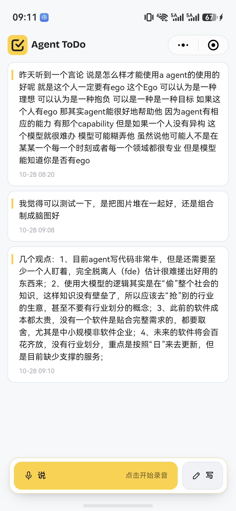
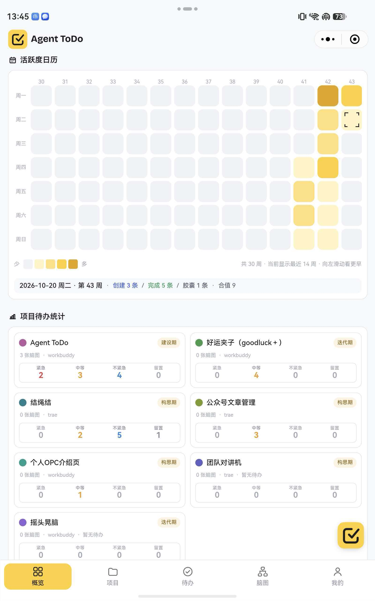
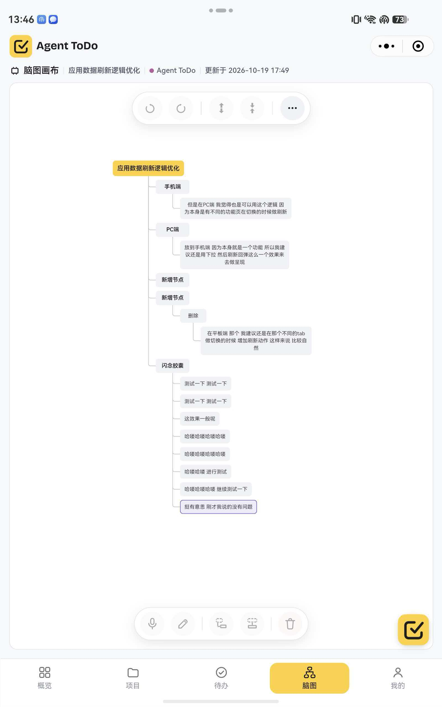
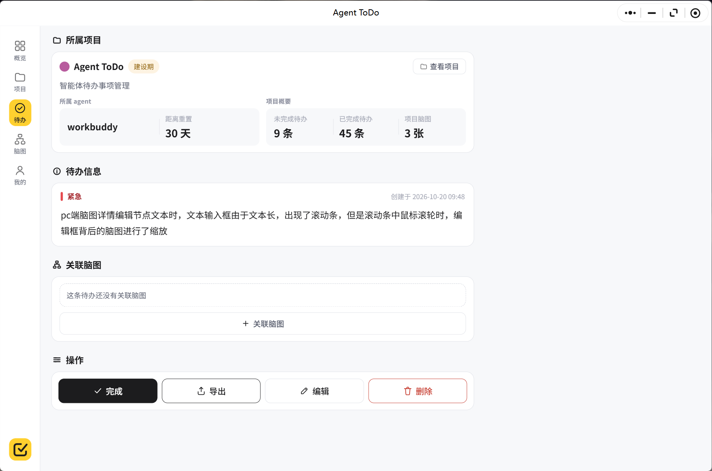

# Agent-ToDo

> 为 FDE（Forward Deployed Engineer，前沿部署工程师）设计的多项目工作台。
> 先记下来，再归到项目、整理成方案，最后连同客户原话与脑图层级一起导出给 Agent。

<p>


</p>

---

## 它解决什么问题

一个人同时跟几条业务线时，真正丢的不是"待办"，而是**切换时的那段上下文**：上次停在哪、为什么这样定、客户当时原话是什么。

Agent-ToDo 不替人做优先级判断，而是把判断需要的材料留在原处：现场那句口头需求可以先一句话收进来，不要求当场归类；整理时再归到项目、拆成脑图、导出成能直接交给 Agent 的任务规格。

核心不是"记更多"，而是**让每条线的上下文都有固定位置**。

---

## 五个核心概念

| 概念 | 是什么 | 一句话 |
|---|---|---|
| 闪念胶囊 | 未归类的现场输入 | 先收进来，再决定归属；支持语音、文字、截图 |
| 项目 | 一条交付线 | 同一客户的不同阶段分别建项目，单级归属，不做父子结构 |
| 待办 | 一件要交的事 | 只归一个项目，带四档紧急度，可关联胶囊、图片与一张脑图 |
| 脑图 | 方案的结构 | 拆开需求、技术决策与验收口径，节点可拖动、可语音改字 |
| 导出 | 交给 Agent 的交接物 | 待办正文 → 图片链接 → 脑图层级 → 关联胶囊 |

---

## 五步工作流

```
① 接住  →  ② 归位  →  ③ 出方案  →  ④ 派活  →  ⑤ 收尾
  手机        平板/PC      平板/PC        PC        平板/PC
  录一条      挂到项目      脑图拆结构    导出 MD    回看节奏
```

五条业务线可以各自处在不同阶段。现场记录可以很快完成，整理则按批次进行 —— 不必为了清零胶囊而强行归类。

---

## 六个模块

| 模块 | 作用 | 手机 | 平板 / PC |
|---|---|:--:|:--:|
| 概览 | 上半屏周期活跃热力，下半屏跨项目待办统计 | — | ✓ |
| 闪念胶囊 | 说、写、截图；单条转待办，多选删除或语义转脑图 | ✓ | ✓ |
| 项目 | 阶段、综合紧急度、待办与脑图数量 | — | ✓ |
| 待办 | 四档紧急度、关联胶囊与图片、导出 Markdown、信息增强 | — | ✓ |
| 脑图 | 六种格式、拖拽改父子、键盘或语音改字、节点配图、语义生成 | — | ✓ |
| 我的 | 个人资料、Agent 套餐余额与重置、Token API | — | ✓ |

手机端刻意只做"接住"：整屏胶囊流 + 底部「说」「写」，没有其他五个模块入口 —— 现场记录时不必同时面对项目、进度与统计。整理请在平板或 PC 完成。

---

## 技术架构

```
┌──────────────────────────── 微信小程序（原生框架）────────────────────────────┐
│  shell 单页                                                                   │
│   ├─ mod-overview / mod-project / mod-todo / mod-mindmap / mod-mine           │
│   ├─ capsule（胶囊流·语音/文字/截图）  todo-card  form-drawer  drawer          │
│   ├─ utils/store.js   唯一内存状态 + 写台账（乐观更新 → 请求 → 回滚）           │
│   └─ utils/api.js     唯一网络出口（token 注入 · 1001 静默重登 · 超时分类）      │
└──────────────────────────────────────┬───────────────────────────────────────┘
                                       │  HTTPS / JSON
┌──────────────────────────────────────┴───────────────────────────────────────┐
│  nginx  静态站 + 反代 + /files 图片 alias                                      │
└──────────────────────────────────────┬───────────────────────────────────────┘
                                       │  127.0.0.1:3000
┌──────────────────────────────────────┴───────────────────────────────────────┐
│  NestJS 10                                                                    │
│   auth(JWT) · me · sync · projects · todos · mindmaps · capsules · agents      │
│   token-keys(AES-256-GCM) · files · asr · ai · admin · health                  │
│                                        │              │              │        │
│                                   Prisma 5      腾讯云 ASR      火山方舟 LLM   │
└────────────────────────────────────────┼───────────────────────────────────────┘
                                         │
                                     MySQL 8
```

### 几个影响全局的设计决策

- **时间字段一律 `String('YYYY-MM-DD HH:mm:ss')`，不用 `DateTime`**。Prisma + MySQL 的 `DateTime` 按 UTC 解释，北京 0:00–8:00 的记录会整体错一天，而活跃热力正是按「日」聚合的。用定长字符串 ⇒ 字典序＝时间序，与 API 契约、前端切片天然一致。
- **图片只存相对路径**。库里的 `uri` 是相对值，对外前缀由 `FILE_BASE_URL` 一处决定 —— 换域名、上 CDN 都是单行改动，且可逆。
- **前端的两个开关不是一件事**。`_mock`（数据源，走本地种子数据）与 `_fallback`（拉不到后端时要不要拿演示数据顶上）分开；`_fallback` 默认关闭，拉不到就清空成真的空 —— 界面上只可能出现数据库里的数据。
- **模型厂商的 API key 加密入库、只回掩码**。AES-256-GCM + scrypt 派生，密文自描述（`v1.<iv>.<tag>.<data>`），出参只有 `sk-****wxyz`。
- **单一 `main` 分支 + 迁移脚本入库**。部署顺序固定为「备份 → `migrate deploy` → `prisma generate` → 重启 → 健康检查」。

---

## 目录结构

```
.
├── miniprogram/            微信小程序（原生框架，无第三方 UI 库）
│   ├── pages/shell/        唯一页面：壳层 + 模块切换
│   ├── components/         mod-*（五个模块）+ capsule / todo-card / drawer …
│   ├── utils/              store（状态与写台账）· api（唯一网络出口）· mock · theme …
│   ├── assets/             图标（浅/深两套 SVG）与品牌图
│   ├── app.js / app.json / app.wxss
│   └── project.config.json 工程配置（appid 为游客态占位）
│
├── server/                 NestJS 后端
│   ├── src/
│   │   ├── auth/ me/ sync/ 鉴权与聚合拉取
│   │   ├── projects/ todos/ mindmaps/ capsules/ agents/   业务模块
│   │   ├── ai/            提示词增强、语义转脑图、链接白名单
│   │   ├── asr/           语音识别（腾讯云一句话识别）
│   │   ├── files/ token-keys/ admin/ health/
│   │   └── common/        统一响应、异常、Prisma、时间与树工具、凭据加密
│   ├── prisma/            schema + 10 个迁移 + 种子数据
│   ├── nginx/             站点与反代配置模板
│   ├── scripts/           backup.sh / deploy.sh
│   └── ecosystem.config.js  PM2 进程配置（不含任何密钥）
│
├── site/                   官网双页（产品首页 + 十章节操作手册）
├── docs/                   架构、数据模型、API、部署
└── profile/                个人主页 README（用于同名仓库）
```

---

## 快速开始

### 依赖

| 项 | 版本 | 说明 |
|---|---|---|
| Node.js | ≥ 20 | 后端运行时 |
| MySQL | 8.0 | 字符集 `utf8mb4` |
| 微信开发者工具 | 最新稳定版 | 小程序端 |
| nginx | ≥ 1.18 | 仅部署时需要 |

### 后端

```bash
cd server
npm install

cp .env.example .env
# 至少填这几项：DATABASE_URL / WX_APPID / WX_SECRET / JWT_SECRET
# 想用语音识别与信息增强，再填 TENCENT_SECRET_* 与 ARK_API_KEY（可留空，相关接口会明确报未配置）

npx prisma migrate deploy      # 建表
npx prisma generate            # 生成客户端
npm run build

npm run seed                   # 可选：灌入演示数据（账号见 SEED_OPENID）
npm start                      # 默认 127.0.0.1:3000

curl http://127.0.0.1:3000/api/v1/health
```

启动后统一入口是 `http://127.0.0.1:3000/api/v1`，所有响应形如：

```json
{ "code": 0, "message": "ok", "data": { } }
```

`code != 0` 即业务错误，`1001` 表示 token 失效（前端会静默重登一次）。

### 小程序

1. 用微信开发者工具导入 `miniprogram/` 目录，AppID 选「测试号」即可（`project.config.json` 里是 `touristappid` 占位）
2. 改 `miniprogram/utils/api.js`：

```js
const BASE = 'https://api.example.com/api/v1';   // ← 换成你的后端地址
```

3. 本机联调有两种姿势：
   - **不连后端**：把 `utils/api.js` 的 `let _mock = false` 改成 `true`，全程走 `utils/mock.js` 的种子数据，一个请求都不发
   - **连本机后端**：`_mock` 保持 `false`，把 `HOST_DEVICE` 改成你开发机的局域网 IP（`ipconfig` 看 WLAN 那个），并同步改 `server/.env` 的 `HOST=0.0.0.0` 与 `FILE_BASE_URL=http://<同一个 IP>:3000` —— 漏了后者的话上传的图会全裂
4. 走真机 / 正式域名时，微信后台要分别加白 `request`、`uploadFile`、`downloadFile` 三类域名，**二级域名不支持泛域名，必须精确添加**

### 环境变量

完整清单与逐项解释见 [`server/.env.example`](server/.env.example)，关键项：

| 变量 | 必填 | 说明 |
|---|:--:|---|
| `DATABASE_URL` | ✓ | MySQL 连接串，**时区必须写 `timezone=+08:00` 的 URL 编码形式** |
| `JWT_SECRET` | ✓ | `openssl rand -hex 32`；换掉＝所有人被登出 |
| `WX_APPID` / `WX_SECRET` | ✓ | 小程序凭据；AppSecret 只能待在服务端 |
| `TOKEN_KEY_ENC_SECRET` | 推荐 | 模型 key 的加密口令；缺失时退回由 JWT_SECRET 派生并告警 |
| `FILE_BASE_URL` | ✓ | 图片对外前缀，与 nginx 的 alias 配套 |
| `TENCENT_SECRET_ID` / `_KEY` | 可选 | 语音识别；缺一项时 `POST /asr` 明确报「语音识别未配置」 |
| `ARK_API_KEY` | 可选 | 信息增强与语义转脑图；留空时报「增强服务未配置」，不静默降级 |
| `ALLOW_ANY_USER` | 可选 | `true` 跳过白名单；只适合临时开放期 |

---

## 界面

| 手机 · 接住 | 平板 · 概览 |
|---|---|
|  |  |

| 平板 · 脑图 | PC 端 · 待办详情 |
|---|---|
|  |  |

完整界面说明见官网手册：[`site/manual.html`](site/manual.html)（十章节、36 张真实截图）。

---

## 部署

生产形态是「nginx + PM2 + MySQL 单机」，项目里给了可直接套用的模板：

```bash
# 1. 数据库
npx prisma migrate deploy && npx prisma generate

# 2. 构建并托管
npm run build
pm2 start ecosystem.config.js --env production
pm2 save && pm2 startup        # 两句都要，否则重启后不会自动拉起

# 3. nginx（把域名换成自己的）
cp nginx/agenttodo.conf /etc/nginx/conf.d/ && nginx -t && nginx -s reload
```

四条不能省的纪律：

- **端口只监听回环**。`HOST=127.0.0.1`，3306 与 3000 都不对外开，对外只有 nginx
- **密钥只活在 `.env`**，不进 `ecosystem.config.js` —— 否则 `pm2 save` 会把密钥定格进 `dump.pm2`
- **发布顺序固定**：备份 → `migrate deploy` → `prisma generate` → 重启 → 健康检查
- **`pm2 reload` 而不是 `restart`**：reload 是平滑重启，正在处理的请求不会被打断

备份与回滚脚本见 `server/scripts/`，完整流程与排障见 [`docs/deployment.md`](docs/deployment.md)。

---

## 数据与隐私

- 公开可体验的小程序是**演示实例**，与任何正式部署互不相通；演示数据不承诺长期保存
- 正式交付按客户独立部署实例与数据库，不同客户不共用入口和账号
- 模型厂商的 API key 加密入库（AES-256-GCM），出参只给掩码；`apiKeyCipher` 永不出现在任何响应里
- 导出到其他平台的 Markdown 会带上图片链接与客户原话 —— **分享前请自行脱敏**

发现安全问题请不要开公开 Issue，处理方式见 [`SECURITY.md`](SECURITY.md)。

---

## 路线图

以下方向仍在开发中，不是当前可用能力：

- **MCP 连接服务** —— 让本地 Agent 按项目与紧急度读取待办，减少 Markdown 的人工搬运，并探索执行状态回写
- **团队服务** —— 提供客户侧反馈入口，把新需求与 bug 汇入待整理池，再由人归到项目
- 失败重试、移动端更多整理动作、脑图与待办的批量操作

当前派活仍靠导出，客户反馈仍由人通过胶囊记录。

---

## 贡献

单人维护项目，欢迎 Issue 与 PR。提交前请确认：

- 不提交任何真实凭据、内网地址与个人隐私
- 改完 `.wxml` / `.wxss` 在开发者工具里真机或模拟器过一遍（编译通过不等于渲染正确）
- 改完 `server/src` 先 `npm run build` 再启动，`dist` 与 `src` 要同步

---

## 许可

[MIT](LICENSE) © 2026 杜春生

第三方服务（微信小程序平台、腾讯云语音识别、火山方舟）按各自条款使用；本仓库不包含任何第三方服务的密钥。

